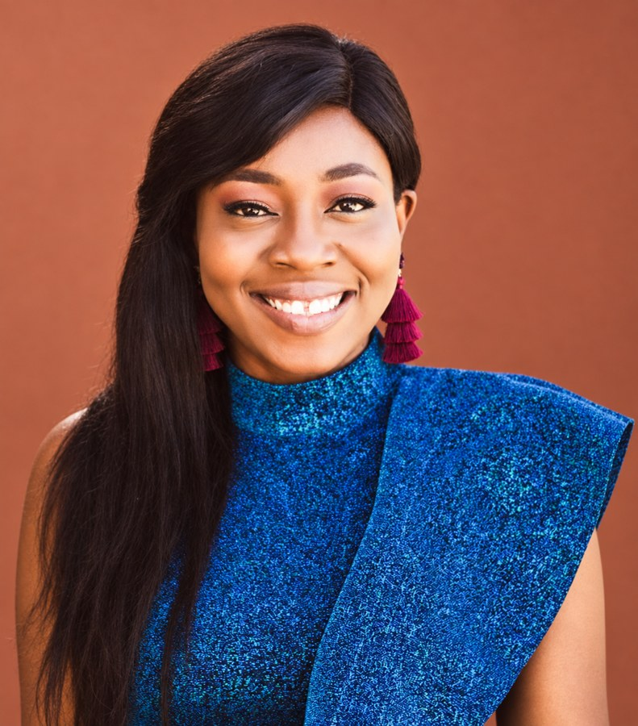

```{=html}
<div class="wrap">

<!-- HERO -->
<section class="hero" id="top">
  <div class="hero-text">
    <div class="eyebrow">Assistant Professor · Department of English · University of Nebraska–Lincoln</div>
    <h1>Mavis Boatemaa Beckson</h1>
    <p class="lede">My work makes space for Black African women’s cultural practices that shed light on communal resilience, uncommon rhetorical performances, and digital material contexts.</p>
    <div class="chips">
      <span class="chip">African Feminisms</span>
      <span class="chip">Digital and Cultural Media</span>
      <span class="chip">Global Black Feminisms</span>
    </div>
    <div class="actions">
      <a class="btn-pill solid" href="publications.html">View publications</a>
      <a class="btn-pill ghost" href="cv.html"><i class="bi bi-download" aria-hidden="true"></i> Download CV</a>
    </div>
  </div>
  <div class="hero-photo">
    
  </div>
</section>

<!-- AT A GLANCE -->
<section class="band" aria-label="At a glance">
  <div class="band-grid">
    <div><div class="label">Currently</div><div class="value">Assistant Professor of English — UNL</div></div>
    <div><div class="label">Doctorate</div><div class="value">Ph.D., New Mexico State University, 2023</div></div>
    <div><div class="label">Born in</div><div class="value">Ghana, West Africa</div></div>
    <div><div class="label">Based in</div><div class="value">Lincoln, Nebraska</div></div>
  </div>
</section>

<!-- 01 ABOUT -->
<section class="numbered" id="about">
  <div class="num-head"><div class="num">01</div><h2>About</h2></div>
  <div class="num-body">
    <p class="lead-p">As a Black woman born in Ghana, West Africa, and currently living in the U.S., I have had the privilege of being a student in two different cultural settings, and had the opportunity of knowing what it is like to learn from teachers who cultivate their classrooms to accommodate and appreciate the diversity their students bring to these spaces. I also know what it is like to not feel seen or heard.</p>
    <p>Based on these embodied experiences, I have grown to understand the importance of cultivating teaching pedagogies and learning practices that are grounded in equity and inclusivity. With a particular focus on African and minoritized communities and coalitional mediated activism, my work follows African feminist and cultural relationality with material things, especially how these material objects shape lives and agency in multicultural African spaces. My work makes space for Black African women’s cultural practices that shed light on communal resilience, uncommon rhetorical performances, and digital material contexts.</p>
  </div>
</section>

<!-- 02 AREAS OF INTEREST -->
<section class="numbered" id="research">
  <div class="num-head"><div class="num">02</div><h2>Areas of interest</h2></div>
  <div class="num-body">
    <div class="cards">
      <div class="card-i"><h3>African Feminisms</h3><p>[FOCUS DETAILS TO BE SUPPLIED]</p></div>
      <div class="card-i"><h3>Digital and Cultural Media</h3><p>[FOCUS DETAILS TO BE SUPPLIED]</p></div>
      <div class="card-i"><h3>Global Black Feminisms</h3><p>[FOCUS DETAILS TO BE SUPPLIED]</p></div>
      <div class="card-i"><h3>Writing and Cultural Material Practices</h3><p>[FOCUS DETAILS TO BE SUPPLIED]</p></div>
      <div class="card-i"><h3>Human and Non-Human Relationality</h3><p>[FOCUS DETAILS TO BE SUPPLIED]</p></div>
      <div class="card-i"><h3>Composition, Rhetoric, and Multicultural Pedagogies</h3><p>[FOCUS DETAILS TO BE SUPPLIED]</p></div>
    </div>
    <div class="focus-row">
      <span class="label">Focus</span>
      <span class="chip-fill">African and minoritized communities</span>
      <span class="chip-fill">Coalitional mediated activism</span>
      <span class="chip-fill">Communal resilience</span>
      <span class="chip-fill">Digital material contexts</span>
    </div>
  </div>
</section>

<!-- 03 SELECTED PUBLICATIONS -->
<section class="numbered" id="publications">
  <div class="num-head"><div class="num">03</div><h2>Selected publications</h2><a href="publications.html">All publications →</a></div>
  <div class="num-body">
    <ol class="pubs">
      <li>
        <div class="yr">2022</div>
        <div class="entry">
          <div class="title">Review of <em>Black or Right: Anti/Racist Campus Rhetorics</em> by Louis M. Maraj</div>
          <div class="meta"><em>Rhetoric Society Quarterly</em>, Volume 52, Issue 2, May 2022.</div>
          <div><span class="tag t-review">Book review</span></div>
        </div>
      </li>
      <li>
        <div class="yr">2020</div>
        <div class="entry">
          <div class="title">Transforming Feminist Narratives and Participation of African Marginalized Women Through Ceremonial Beads</div>
          <div class="meta"><strong>Beckson, Boatemaa Mavis</strong> · <em>Peitho Journal</em>, Volume 22, Issue 3, Spring 2020.</div>
          <div><span class="tag t-article">Peer-reviewed article</span></div>
        </div>
      </li>
      <li>
        <div class="yr">In prog.</div>
        <div class="entry">
          <div class="title">On Being Black African Immigrant Teacher: Rethinking Representation at the Intersection of Language, Race, and Inclusivity in Higher Education</div>
          <div class="meta"><strong>Beckson, Boatemaa Mavis</strong> · To be published in <em>The Black Caucus Project Collection</em>, edited by Richard Green and Jamal Cooks. NCTE Press. Tentative publication year, 2023.</div>
          <div><span class="tag t-prog">Book chapter · in progress</span><span class="tag t-prog">[CURRENT STATUS TO BE SUPPLIED]</span></div>
        </div>
      </li>
    </ol>
  </div>
</section>

<!-- 04 EDUCATION -->
<section class="numbered" id="experience">
  <div class="num-head"><div class="num">04</div><h2>Experience &amp; education</h2><a href="cv.html">Full CV →</a></div>
  <div class="num-body">
    <div class="timeline">
      <div class="t-item"><div class="rail"><div class="dot"></div><div class="stem"></div></div>
        <div><div class="when">[START YEAR TO BE SUPPLIED] — Present</div><h3>Assistant Professor, Department of English</h3><div class="where">University of Nebraska–Lincoln</div></div></div>
      <div class="t-item"><div class="rail"><div class="dot open"></div><div class="stem"></div></div>
        <div><div class="when">2023</div><h3>Ph.D.</h3><div class="where">New Mexico State University</div></div></div>
      <div class="t-item"><div class="rail"><div class="dot open"></div><div class="stem"></div></div>
        <div><div class="when">2018</div><h3>M.A.</h3><div class="where">New Mexico State University</div></div></div>
      <div class="t-item"><div class="rail"><div class="dot open"></div><div class="stem"></div></div>
        <div><div class="when">2015</div><h3>B.A.</h3><div class="where">Kwame Nkrumah University of Science and Technology</div></div></div>
    </div>
  </div>
</section>

<!-- CONTACT -->
<section class="contact" id="contact">
  <div class="c-text">
    <h2>Get in touch.</h2>
    <p>Department of English, University of Nebraska–Lincoln · Lincoln, NE</p>
  </div>
  <div class="c-links">
    <a href="mailto:[EMAIL TO BE SUPPLIED]"><i class="bi bi-envelope" aria-hidden="true"></i> [EMAIL TO BE SUPPLIED]</a>
    <a href="https://www.linkedin.com/in/mavis-beckson-ph-d-287381113"><i class="bi bi-linkedin" aria-hidden="true"></i> LinkedIn</a>
    <a href="https://engl.unl.edu"><i class="bi bi-building" aria-hidden="true"></i> UNL Department of English</a>
    <a href="cv.html"><i class="bi bi-file-earmark-text" aria-hidden="true"></i> Curriculum vitae</a>
  </div>
</section>

</div>
```
